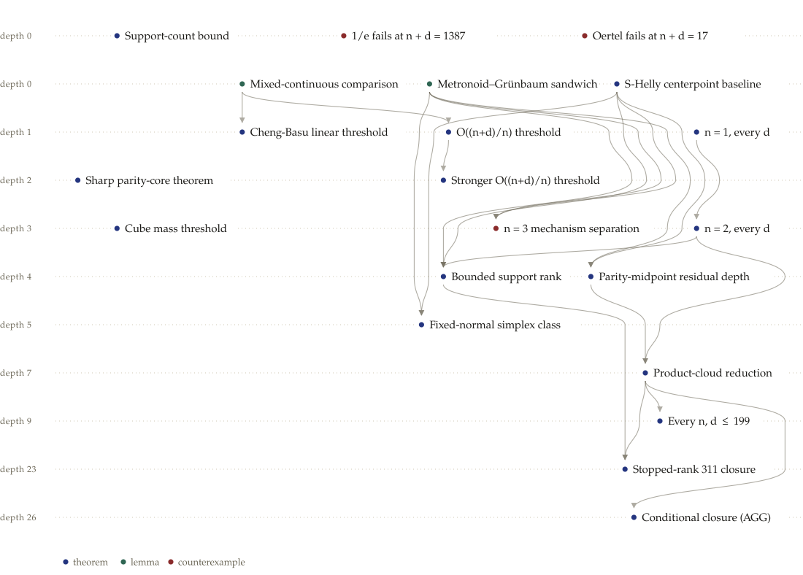

# Weak Oertel conjecture

A private collaboration repository for the fact graph of the weak Oertel conjecture for mixed-integer volume. The general conjecture remains open; this graph contains no accepted final proof.

The [problem statement](problem_statement.md) asks for an absolute constant $c_0\in(0,1/e)$ such that every convex body in $\mathbb R^{n+d}$ with a nonempty mixed-integer intersection has a mixed-integer point of halfspace depth at least $c_0 2^{-n}$ times its total mixed-integer volume. The constant must be independent of both $n$ and $d$.

Start with the highlights below, then follow a fact's `depends_on` IDs. The [complete fact index](INDEX.md) lists every accepted node. See [CONTRIBUTING.md](CONTRIBUTING.md) for adding results or raising a proof issue.

## Status and verification

The initial snapshot contains 1,235 accepted facts: 712 theorems, 317 lemmas, and 206 counterexamples to intermediate claims. Its latest acceptance is dated 29 October 2026. Those initial facts have the recorded assurance label `LLM-verified` and their original model-verification records. Later additions state their review method explicitly in their own records. This label does not assert human review or formal certification. Counterexamples to intermediate mechanisms do not disprove the general conjecture.

On 7 November 2026, the integration review of PRs #4–#8 covered all **39 newly accepted facts**, bringing the graph to **1,280 accepted facts**, 2,571 candidates, and 1,340 verification runs. The lead assistant and three separate AI reviewers checked the proofs, reran the exact counterexample certificates, and freshly compiled the complete Lean project. A supporting sign-cone checker was corrected to keep every arithmetic value rational; its mathematical certificate remains valid. The [integration review and reproducible evidence](reviews/pr4-8-integration-review.md) record the exact revisions, individual proof coverage, fix, checks, and formalization limits. This review does not imply human certification or approval of the remaining pending submissions.

The recorded subgoal statuses are research history, not a freshly reviewed list of available assignments. Some subgoals mention unshared research notes; reconstruct their mathematical target from accepted facts before using them. The README highlights are navigation aids, not an additional verification of the results.

## Counterexample to the specific 1/e bound in total dimension 1387

A full-dimensional rational polytope with **$(n,d)=(209,1178)$** has
normalized mixed-integer halfspace depth uniformly below
$0.36787944/2^{209}<1/(e2^{209})$. The [proof and exact replay](facts/a02d398c0677c03a.md)
cover every mixed-integer point. The [Lean theorem](lean/SharpOC/Witness1387/DepthBound.lean)
proves the depth bound for the explicit witness. The
[verification guide](research/one-over-e-1387/README.md) gives the
reproduction and axiom audit commands.

## Counterexample of total dimension 17

A rational polytope with **$(n,d)=(12,5)$** has normalized mixed-integer
depth uniformly below $(5/6)^5/2^{12}$. Selector-dependent signs on the
ordinary coordinates give three light pools of 252 fibers each using
two selector coordinates. The proof accounts for all $4{,}852$ integer
fibers and gives a containing halfspace at every mixed-integer point.
[Accepted fact](facts/ecbacdec2c429376.md) ·
[Geometric proof](research/sharp-dimension-17/README.md) ·
[Exact replay](research/sharp-dimension-17/check.py) ·
[Lean theorem](lean/SharpOC/Selector17Counterexample.lean).

## Counterexample of total dimension 19

A rational polytope with **$(n,d)=(14,5)$** has normalized mixed-integer
depth uniformly below $(5/6)^5/2^{14}$. Its $17{,}770$ integer fibers
are identified exactly. The [geometric proof](research/sharp-dimension-19/README.md),
[exact replay](research/sharp-dimension-19/check.py), and
[Lean theorem](lean/SharpOC/SelectorCounterexample.lean) verify the strict bound.

## Earlier counterexamples of total dimension 187

The [dimension-reduction submission](research/sharp-dimension-187/README.md) gives rational counterexamples to the sharp bound $\Gamma_d/2^n$, where $\Gamma_d=(d/(d+1))^d$, at **(n,d)=(153,34), (132,82), and (129,104)**. Their actual fibers and every-point halfspace bounds are proved, and their maximum depths are determined exactly. These examples satisfy the weaker $1/(e2^n)$ bound.

The same submission improves the specific $1/e$ counterexample to **n=52, d=1,345,226,000,000,000,003**, using one simplex factor for both amplification and caps. It also proves the support-count obstruction that forces $d\ge68,727,866,368$ for any $1/e$ counterexample on the old n=52 support. The three new records bring the graph to **1,283 accepted facts**, 2,574 candidates, and 1,343 verification runs. Independent mathematical reviews and exact rational checks are recorded with `LLM-verified` assurance; these additions are not Lean-formalized. See the [final publication review](research/sharp-dimension-187/publication-review.md).

## PK November 6 contribution

See [the short contribution guide](contributions-PK-nov-6-merge.md) for the main additions and [the complete pending-submission index](assets/pk-nov6/INDEX.md) for the wider collection. The original mathematical notes, computations, and historical review comments remain preserved pending intake. They did not themselves change the accepted facts or the target.

On 6 November 2026 (America/New_York), six atomic claims from the near-parity-core proof were accepted after direct ChatGPT mathematical review, including [the sharp complete-parity-core theorem](facts/3fad02a5aa48ae2a.md). That review brought the accepted graph to **1,241 facts**. All original intake files and their pending statuses are unchanged; the normalized accepted replacements and exact scope are listed in [the review report](reviews/pk-parity-core-issue2.md). Each new node has a fresh review record and a closed accepted dependency chain. The same assistant edited and reviewed the normalization; no second-model, human, or formal review is implied. The other imported claims have not been batch-approved.

The [subsequent continuation](assets/pk-continuation-2026-11/README.md) adds separately reviewed facts. Its earlier [explicit counterexample to the specific 1/(e*2^n) bound](facts/df488edae05a1702.md) has **n=52** and **d=274784+2^61**, about **2.31×10^18**. Two independent mathematical reviews and an exact rational certificate cover the actual fibers and every mixed-integer point; see the [review report](reviews/pk-n52-counterexample.md). This is an intermediate dimension reduction and is **not Lean-formalized**. It remains far above a billion continuous variables. It refutes the particular constant 1/e, not this repository's target of some smaller positive absolute constant. The original pending intake retains its existing status.

A [six-page writeup](output/pdf/oertel-52-integer-variables.pdf) explains the new Boolean family of outer fibers, the affine proof that the origin fiber is exact, and the mass surplus that permits smaller simplex padding. Its [LaTeX source](assets/pk-continuation-2026-11/oertel-52-integer-variables.tex) is included.

The earlier [n=76 counterexample](facts/a5291bca09ba4b1e.md), with **d=1372131+2^93**, has a [complete Lean proof](lean/README.md) in the mixed-integer-volume formulation. The [formal audit](lean/ONE_OVER_E_AUDIT.md) records its exact scope, and the [analytic review report](reviews/pk-one-over-e-counterexample.md) preserves its original review history.

A [six-page LaTeX writeup](output/pdf/oertel-one-over-e-counterexample.pdf) presents the n=76 construction, proof, exact arithmetic, and formal scope. Its [editable source](assets/pk-continuation-2026-11/oertel-one-over-e-counterexample.tex) is included.

The earlier [sharp-bound counterexample](facts/022a26fa5001480a.md), with d=23 and n=3*10^92, has a [complete Lean proof in the mixed-integer-volume formulation](lean/README.md), including the actual convex body, all integer fibers, and a uniform strict depth bound. The pinned build and standard-axiom audit pass. Both constructions are included in the pinned Lean build. See the linked scope statement for the additional rationality/Hausdorff-normalization details in the prose note; the historical fact-review metadata is unchanged.

## Highlights

These curated names come from the existing project overview. Rows give the longest dependency-chain length, starting at zero. An arrow in the picture means that a lower highlighted fact depends on an upper one, possibly through omitted nodes.

<picture>
  <source media="(prefers-color-scheme: dark)" srcset="assets/highlights-dark.svg">
  
</picture>

| depth | name | fact |
|---|---|---|
| 0 | S-Helly centerpoint baseline | [`6d6fcf377e68c79c`](facts/6d6fcf377e68c79c.md) |
| 0 | Mixed-continuous comparison | [`4cfd86cd551df9e7`](facts/4cfd86cd551df9e7.md) |
| 0 | Metronoid–Grünbaum sandwich | [`6769574fc1bd9f8d`](facts/6769574fc1bd9f8d.md) |
| 1 | n = 1, every d | [`758103b1282d6b91`](facts/758103b1282d6b91.md) |
| 1 | Cheng-Basu linear threshold | [`1787daa1dbe3fbb4`](facts/1787daa1dbe3fbb4.md) |
| 1 | O((n+d)/n) threshold | [`0790372855abe672`](facts/0790372855abe672.md) |
| 2 | Stronger O((n+d)/n) threshold | [`95b9903fc7036094`](facts/95b9903fc7036094.md) |
| 3 | n = 2, every d | [`daef2580cdfec07b`](facts/daef2580cdfec07b.md) |
| 3 | Cube mass threshold | [`daf10421c94b79ba`](facts/daf10421c94b79ba.md) |
| 3 | n = 3 mechanism separation | [`c168604b1c021192`](facts/c168604b1c021192.md) |
| 4 | Bounded support rank | [`9468b734966ba646`](facts/9468b734966ba646.md) |
| 4 | Parity-midpoint residual depth | [`be359f8a6c628483`](facts/be359f8a6c628483.md) |
| 5 | Fixed-normal simplex class | [`cb0d20326035a553`](facts/cb0d20326035a553.md) |
| 7 | Product-cloud reduction | [`6b09aae189415c70`](facts/6b09aae189415c70.md) |
| 9 | Every n, d ≤ 199 | [`245739007817b92a`](facts/245739007817b92a.md) |
| 23 | Stopped-rank 311 closure | [`a728f1f23a4398e9`](facts/a728f1f23a4398e9.md) |
| 26 | Conditional closure (AGG) | [`933fa3d0a98a6ce9`](facts/933fa3d0a98a6ce9.md) |

Recent additions beyond the curated overview:

- [A sharp-bound counterexample in total dimension 19](facts/a39d93bee9bf2fe9.md)
- [Sharp counterexamples with total dimension 187 and further tradeoffs](facts/ad3e63c52f083457.md)
- [A smaller n=52 counterexample using one simplex factor](facts/cbe1f4518f7088a7.md)
- [A support-count obstruction for the specific 1/e bound](facts/30b899ae9d94a523.md)
- [A 52-integer-variable counterexample to the specific 1/e bound](facts/df488edae05a1702.md)
- [Sharp complete-parity-core theorem, with six-node verified dependency chain](facts/3fad02a5aa48ae2a.md)
- [oct29-dominant-clique-lacunary-product](facts/0e1d1c8120a9ffff.md)
- [oct29-four-atom-core-lacunary-product](facts/d727395b991f2895.md)
- [oct29-four-atom-weighted-core-price](facts/149d1105f63274b9.md)
- [oct29-bounded-core-lacunary-product](facts/6d5cb397c4ad27d5.md)
- [oct29-same-cluster-recurrence-adversary](facts/667c2d50a40d42a4.md)

## Files

- `facts/<id>.md`: accepted statements and proofs, with dependencies and the approving verifier run.
- `candidates/<id>.json`: submitted statements and proofs, including rejected and pending work. The corresponding status is in `state.json`.
- `verifications/<run>.json`: original verifier verdicts and explanations.
- `state.json`: facts, candidate statuses, verification runs, and mathematical subgoals.
- `assets/`: the curated highlight labels and dependency diagrams.
- `scripts/check_graph.py`: checks dependency closure, acyclicity, record consistency, verifier hashes, and private-path patterns.

The layout follows [oertel-three-slices-2d](https://github.com/Hongyu-Cheng/oertel-three-slices-2d). This is a fresh repository with no inherited working-directory history. Personal configuration, prompts, handoffs, packets, source archives, working memory, and reference-paper copies are omitted. Original agent names are normalized to `research-agent`; local source locations become citation labels or references to unshared research notes. Packet and prompt metadata are omitted, and verification paths are relative to this repository. Fact IDs, mathematical statements, proofs, dependencies, assurance labels, and verifier verdicts are preserved.

The original problem and fact files retain their LaTeX delimiters. GitHub may display `\(...\)` and `\[...\]` as source; use a math-aware Markdown viewer when needed.

Check the graph locally with:

```sh
python3 scripts/check_graph.py
```
